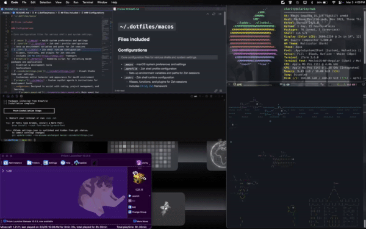
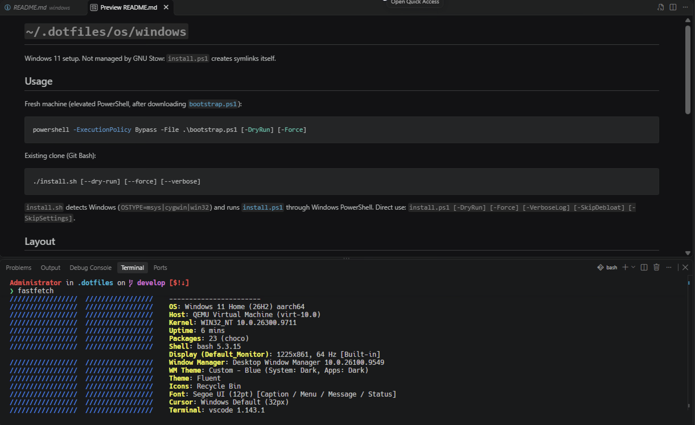
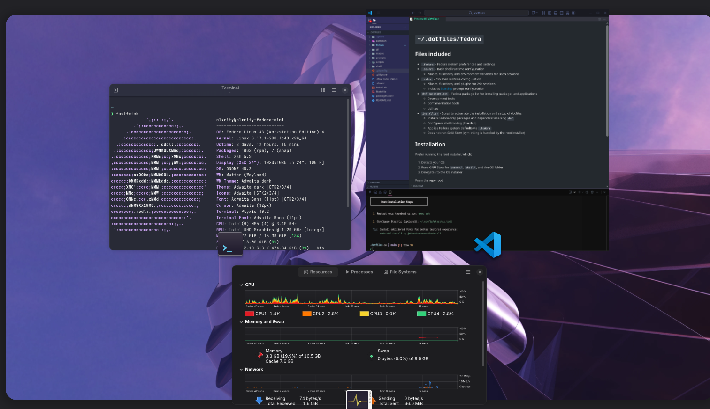
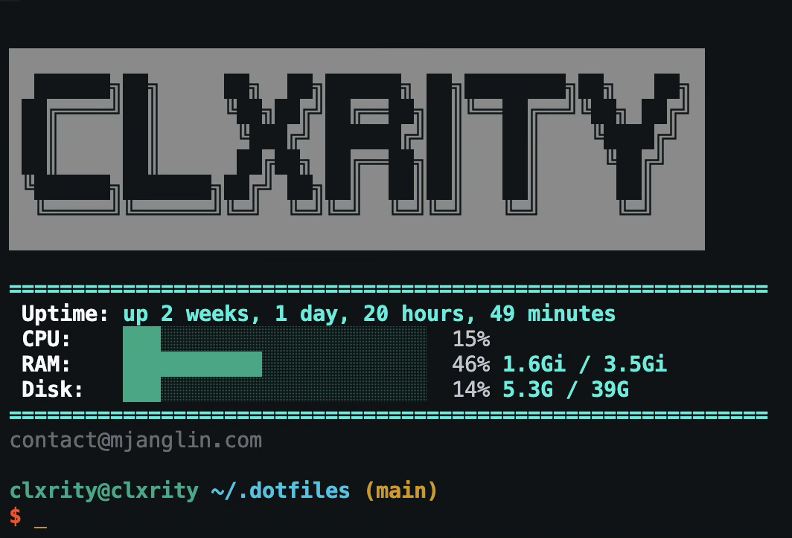
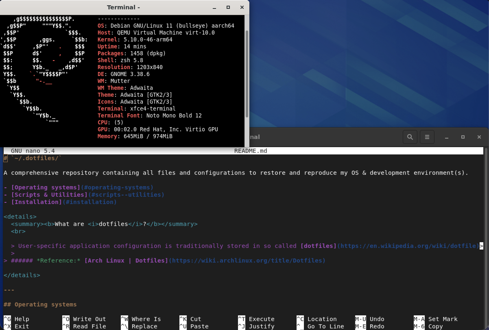

# `~/.dotfiles/`


A comprehensive repository containing all files and configurations to restore and reproduce my OS & development environment(s).

- [Operating systems](#operating-systems)
- [Scripts & Utilities](#scripts--utilities)
- [Installation](#installation)

<details>
  <summary><b>What are <i>dotfiles</i>?</b></summary>
  <br>

  > User-specific application configuration is traditionally stored in so called [dotfiles](https://en.wikipedia.org/wiki/dotfile) (files whose filename starts with a dot). It is common practice to track dotfiles with a [version control system](https://wiki.archlinux.org/title/Version_control_system) such as [Git](https://wiki.archlinux.org/title/Git) to keep track of changes and synchronize dotfiles across various hosts.
  >
> ###### *Reference:* [Arch Linux | Dotfiles](https://wiki.archlinux.org/title/Dotfiles)

</details>

---

## Operating systems

Each OS folder under `os/` contains specific configurations, scripts, and installation instructions.

> Note: shared shell configs and repo-wide config live outside OS folders:
>
> - `shell/` (e.g. `.bash_profile`)
> - `common/` (e.g. `.editorconfig`)

- [macOS](./os/macos/README.md)
- [Windows](./os/windows/README.md)

<table>
  <tr style="text-align:center;">
    <th><a href="./os/macos/README.md"></a></th>
    <th><a href="./os/windows/README.md"></a></th>
  </tr>
  <tr>
    <td></td>
    <td></td>
  </tr>
</table>

- [Fedora](./os/fedora/README.md)
- [Rocky Linux](./os/rocky/README.md)
- [Debian](./os/debian/README.md)

<table>
  <tr style="text-align:center;">
    <th><a href="./os/fedora/README.md"></a></th>
    <th><a href="./os/rocky/README.md"></a></th>
    <th><a href="./os/debian/README.md"></a></th>
  </tr>
  <tr>
    <td></td>
    <td></td>
    <td></td>
  </tr>
</table>

## Scripts & Utilities

- [scripts/README.md](./scripts/README.md)

View all scripts/utilities and how to use them by running:

```bash
make help
```

> [!NOTE]
> 
> When using `make` to execute script-wrapper targets, pass arguments like:
>
> ```bash
> make <target> ARGS="<args to pass to script>"
> ```
>
> *OR:*
>
> ```bash
> make <target> -- <args to pass to script>
> ```

## Installation


The bootstrap downloads **only** your OS's files, verifies them against `SHA256SUMS`, extracts them to `~/.dotfiles`, and runs `install.sh`.

```bash
# Auto-detect OS 
curl -fsSL https://clxrityy.github.io/dotfiles/install.sh | bash

# Pin an OS and pass installer flags
curl -fsSL https://clxrityy.github.io/dotfiles/macos.sh | bash -s -- --dry-run --verbose

# Download/extract only, run the installer later
curl -fsSL https://clxrityy.github.io/dotfiles/install.sh | bash -s -- --no-install

# Read it first
curl -fsSL https://clxrityy.github.io/dotfiles/install.sh | less
```

Windows 11 (elevated PowerShell):

```powershell
irm https://clxrityy.github.io/dotfiles/install.ps1 | iex
# with flags:
& ([scriptblock]::Create((irm https://clxrityy.github.io/dotfiles/install.ps1))) -DryRun
```

> [!NOTE]
>
> - Bootstrap options: `--os <key>`, `--dir <path>` (default `~/.dotfiles`), `--no-install`. Everything else goes to `install.sh`.
> - Re-running updates the bundle in place and keeps `~/.dotfiles/private/`. It refuses to touch a directory that is a git clone or isn't a bundle.
> - Build the site locally with `make pages` (output in `dist/`).

---

## TO-DO

- [x] CI
- [x] Windows
- [x] Debian
- [ ] Ventoy USB setup
- [x] Package migration script
- [x] Quick install via GitHub Pages
- [ ] Development-specific environments
- [ ] VPN configurations
- [ ] SSH config management
- [ ] Container setups (Docker)
